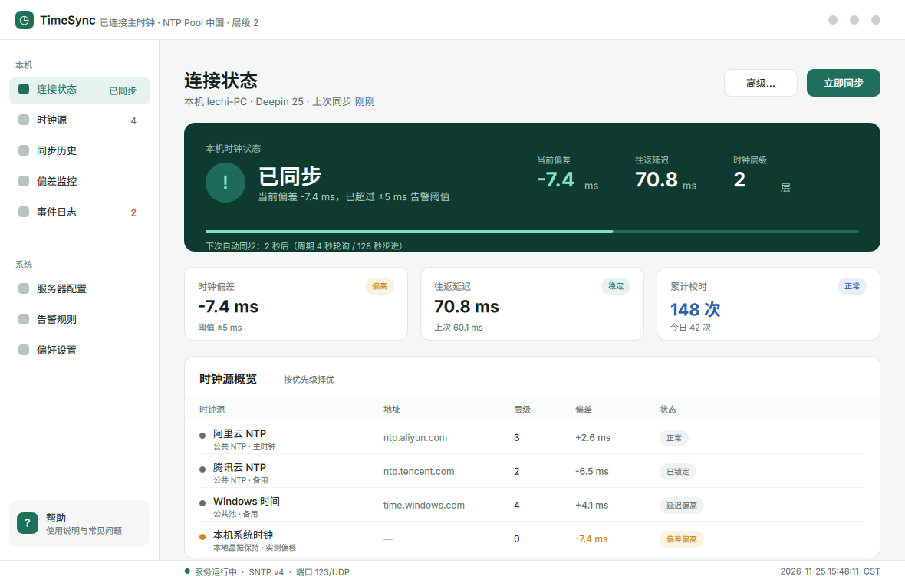
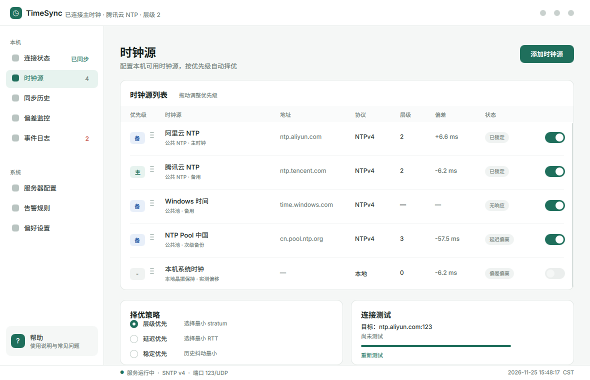
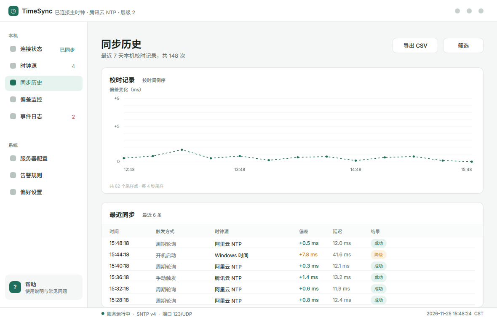
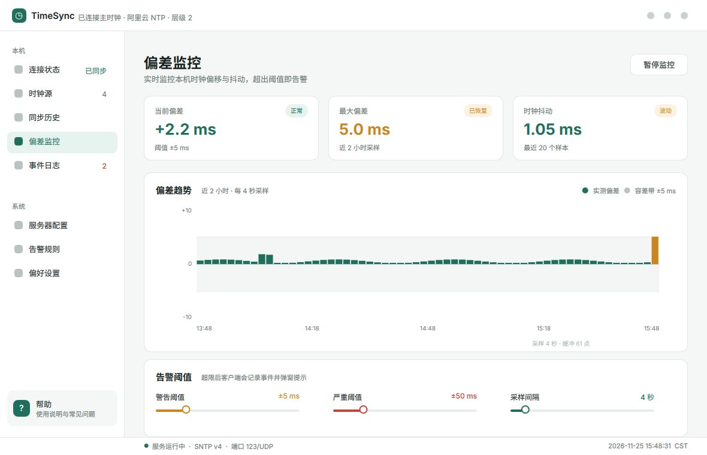
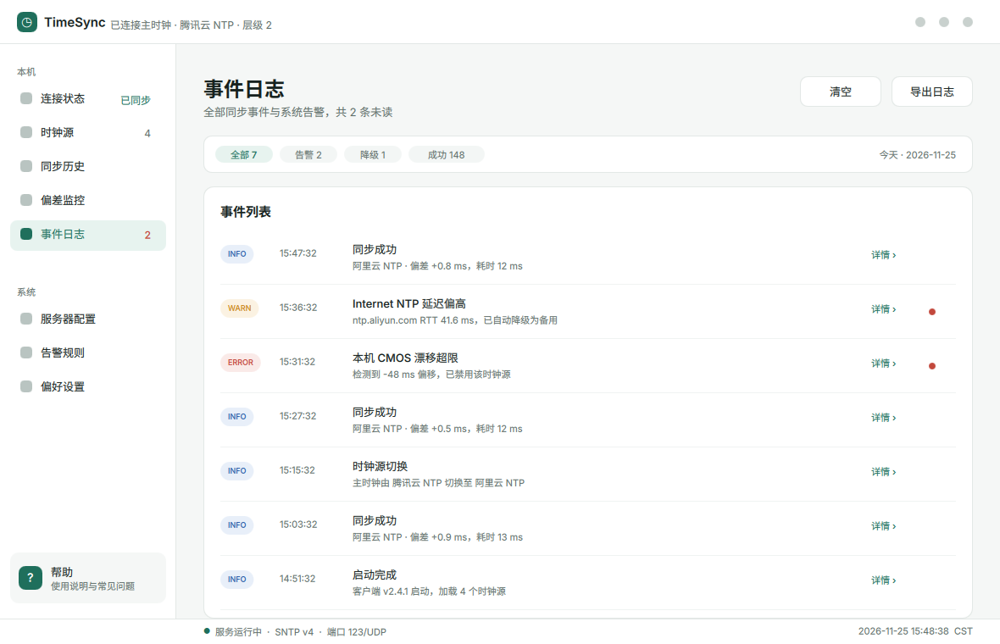
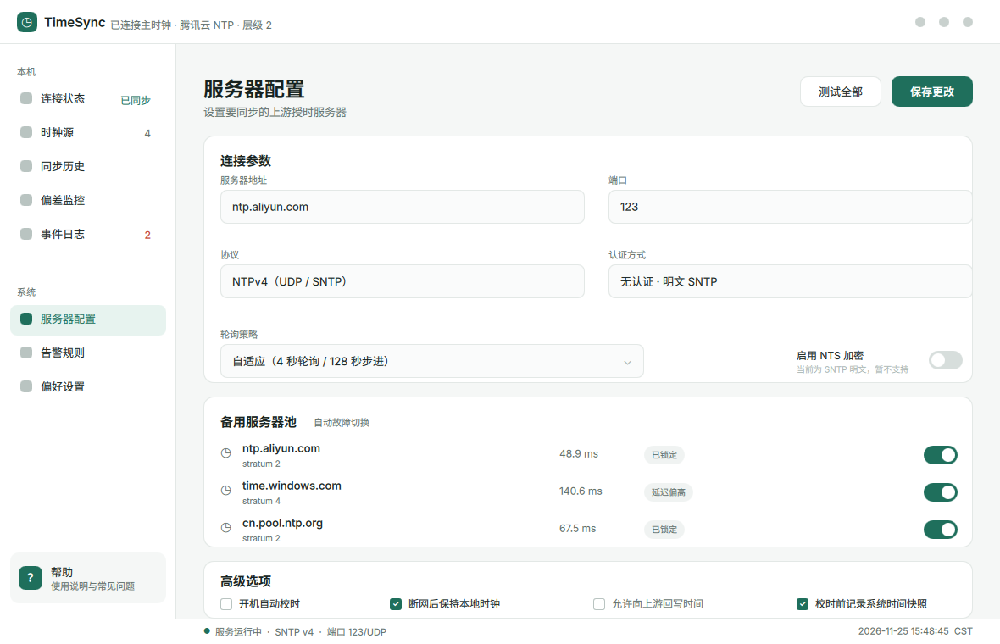
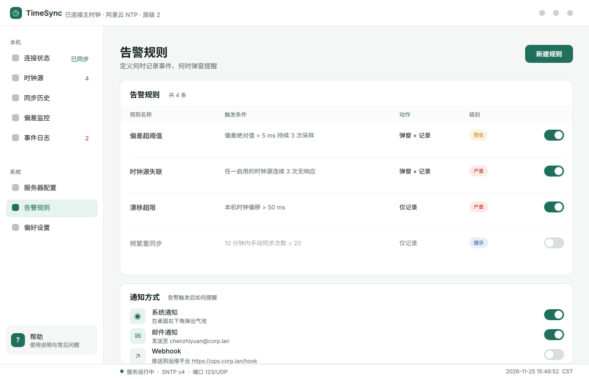
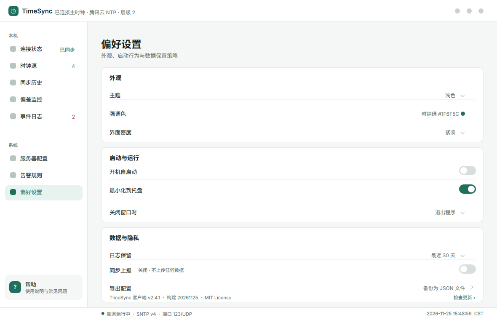

# TimeSync 时间同步客户端

基于 Qt 6 / QML 的桌面时间同步客户端。界面按 FigCraft 设计稿实现（1180×760 无边框窗口，8 个页面），后端直接对接公网 NTP 服务器，以 SNTP v4（RFC 4330）探测本机时钟偏差、往返延迟与抖动，并维护同步历史、事件日志和告警。

## 界面预览

| 连接状态 | 时钟源 |
| :---: | :---: |
|  |  |

| 同步历史 | 偏差监控 |
| :---: | :---: |
|  |  |

| 事件日志 | 服务器配置 |
| :---: | :---: |
|  |  |

| 告警规则 | 偏好设置 |
| :---: | :---: |
|  |  |

## 功能特性

- **真实 SNTP**：UDP/123 发送 SNTP v4 请求，记录 T1–T4 时间戳，计算偏移与 RTT；异步非阻塞，带 DNS 缓存与超时处理。
- **多源择优**：内置阿里云、腾讯云、Windows 时间、NTP Pool 等时钟源，可增删、启停；支持层级优先 / 延迟优先 / 稳定优先三种策略，带迟滞选主，避免主时钟来回抖动。
- **偏差监控**：实时偏差与 RTT、抖动、最近采样曲线；警告 / 严重阈值与采样间隔可调。
- **告警状态机**：偏差需连续 3 次采样超阈值才记录并提醒，回落到阈值 80% 以下自动复位；主时钟切换事件 2 分钟内不重复记录。
- **同步历史**：最近 120 条校时记录（时间、触发方式、时钟源、偏差、延迟、结果），以及近 2 小时的偏差采样曲线（按采样间隔滚动保留，至少 60 点）。
- **事件日志**：未读计数、分类筛选、详情弹窗、标记已读、清空；最多保留 300 条。
- **导出**：校时记录导出 CSV、事件日志导出 `.log`、配置备份导出 JSON，均写入系统「文档」目录。
- **持久化**：主题（浅色 / 深色 / 跟随系统）、界面密度、阈值、通知渠道、关闭行为、开机自启动（写入 XDG autostart）均通过 QSettings 保存。
- **托盘与窗口**：系统托盘图标，双击显示 / 隐藏，右键菜单「立即同步 / 退出」；无边框窗口，自绘标题栏可拖动，右下角可缩放。

> 客户端仅做监控与展示，**不会修改系统时钟**。

## 构建

依赖：

| 依赖 | 版本 / 说明 |
| --- | --- |
| Qt | 6.5+（Quick、QuickControls2、Network、Widgets） |
| CMake | 3.21+ |
| 编译器 | 支持 C++17（GCC / Clang） |
| Ninja | 可选，推荐 |

Deepin / Ubuntu / Debian：

```bash
sudo apt update
sudo apt install build-essential cmake ninja-build \
    qt6-base-dev qt6-declarative-dev \
    qml6-module-qtquick-controls qml6-module-qtquick-window
```

编译与运行：

```bash
cmake -S . -B build -G Ninja -DCMAKE_BUILD_TYPE=Release
cmake --build build
./build/timesync-client
```

## 命令行参数

| 参数 | 说明 |
| --- | --- |
| `--page <n>` | 启动后显示的页面索引（0–7） |
| `--shot <file>` | 渲染窗口到 PNG 后退出（自动使用 offscreen 平台） |
| `--demo` | 填充演示用图表、历史与事件数据，便于截图 |
| `--shot-delay <ms>` | 截图前等待时间，默认 6000 ms |

重新生成全部页面截图：

```bash
mkdir -p shots
for i in 0 1 2 3 4 5 6 7; do
    ./build/timesync-client --page $i --shot shots/p$i.png --demo --shot-delay 6500
done
```

## 配置与数据

- 配置：`~/.config/TimeSync/TimeSync-Client.conf`（QSettings INI）
- 开机自启：开启后写入 `~/.config/autostart/timesync-client.desktop`，关闭时删除
- 导出文件：`~/Documents/TimeSync-校时记录-*.csv`、`TimeSync-事件日志-*.log`、`TimeSync-配置备份-*.json`
- 记录上限：校时记录 120 条、事件 300 条，超出后丢弃最旧数据

## 实现说明

- `src/ntpprobe.*`：SNTP v4 探测。请求 LI=0 / VN=4 / Mode=3，解析服务器 stratum 与 T2/T3，按 `offset = ((T2−T1)+(T3−T4))/2`、`delay = (T4−T1)−(T3−T2)` 计算。
- `src/synccore.*`：同步引擎。默认 4 秒快速轮询（每 128 秒记录一次步进，另有手动与开机同步记录），负责选主、告警、统计、导出和 QSettings 持久化，并暴露为 QML 的 `Engine` 上下文属性。
- `qml/Theme.qml`：设计令牌单例，浅色 / 深色两套色值；`qml/components/` 为通用控件（开关、滑块、组合行、图表、徽标等），`qml/pages/` 为 8 个页面。
- `qml/Main.qml`：无边框主窗口，自绘标题栏、侧栏、状态栏、Toast，以及托盘/关闭行为。

## 目录结构

```text
.
├── CMakeLists.txt
├── assets/fonts/            # Inter 字体（嵌入 qrc）
├── src/
│   ├── main.cpp             # 入口、命令行、托盘、截图
│   ├── ntpprobe.h/.cpp      # SNTP v4 探测
│   └── synccore.h/.cpp      # 同步引擎与持久化
├── qml/
│   ├── Main.qml
│   ├── Theme.qml            # 设计令牌单例
│   ├── TitleBar.qml
│   ├── Sidebar.qml
│   ├── StatusBar.qml
│   ├── Toast.qml
│   ├── components/          # 通用控件
│   └── pages/               # 8 个页面
└── shots/                   # 页面截图
```

## 已知限制

- NTS（Network Time Security）未实现，服务器配置页的 NTS 开关为禁用态并标注「暂不支持」。
- 需要 root 权限的 `clock_settime` / `adjtime` 未被调用，客户端不回写本机时钟。
- 公网 NTP 可达性取决于网络环境，`time.windows.com` 在部分国内网络长期无响应，界面会如实显示「无响应」并降级到其他源。

## 彩蛋

标题栏左上角的时钟图标，连点 5 次试试。
